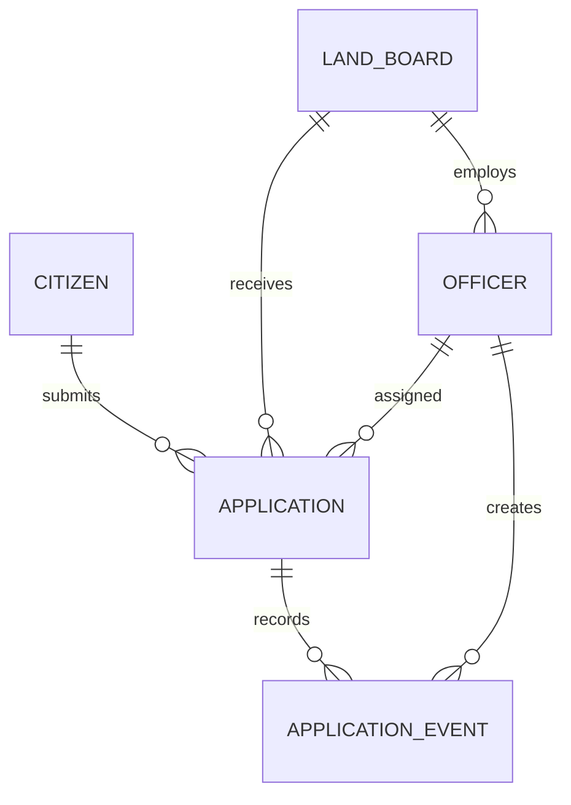
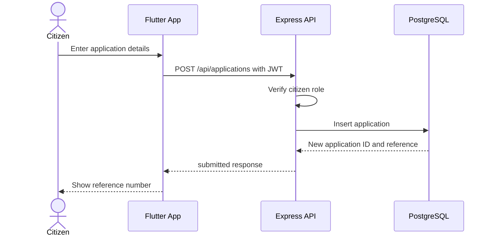
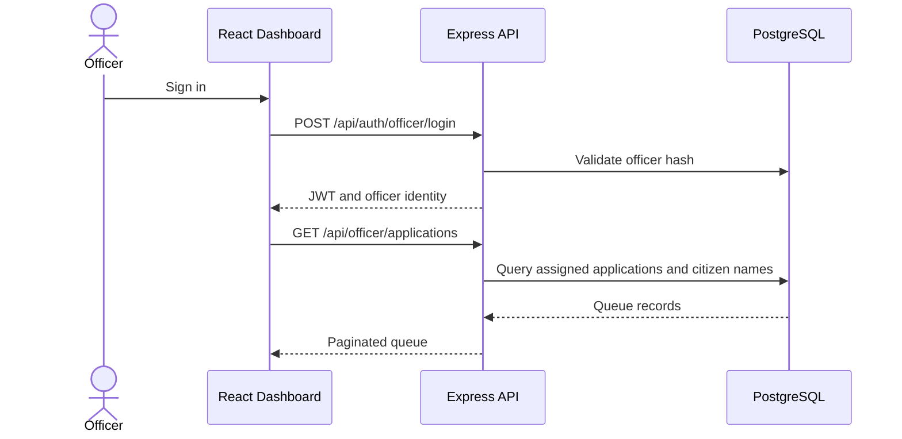
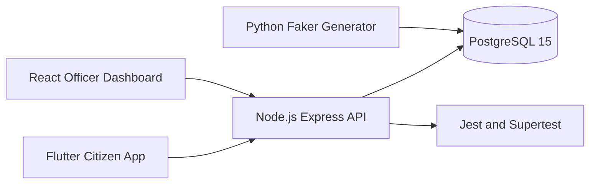

# Review 2 System Diagrams

These Mermaid diagrams are the source-controlled draft artifacts for Review 2. They can be rendered by GitHub, VS Code extensions, or exported to Draw.io/SVG for presentation.

## Entity relationship diagram

## Citizen application submission

## Officer review

## Component view

## Review 2 follow-ups

- Export these diagrams to Draw.io or SVG if a native diagram file is required by the review rubric.
- Add the ML pipeline participant when the model service contract is finalized.